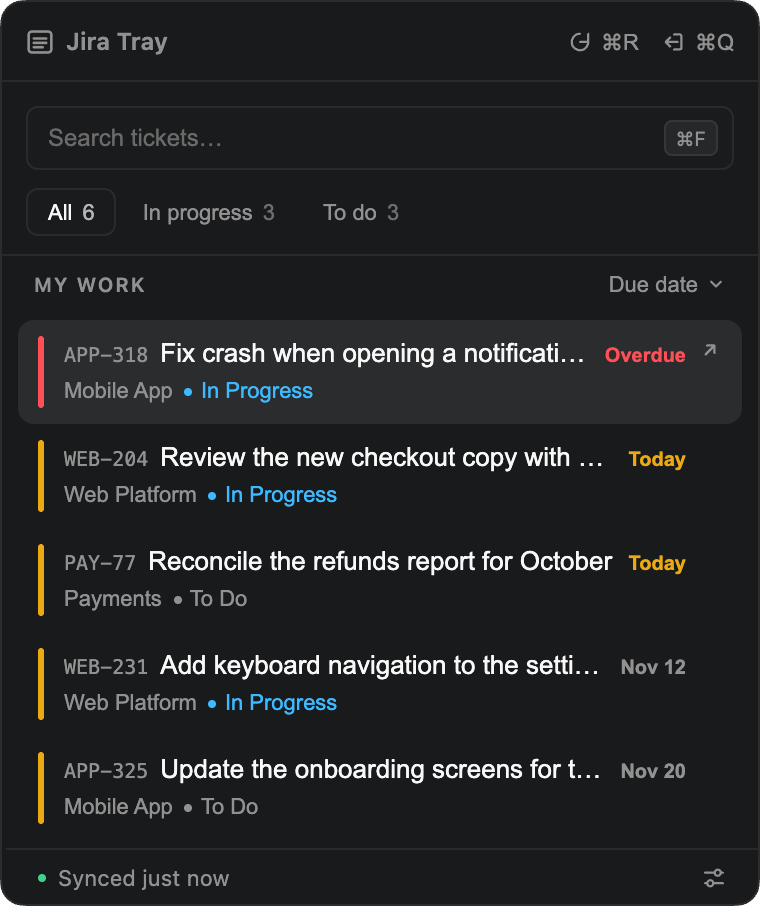
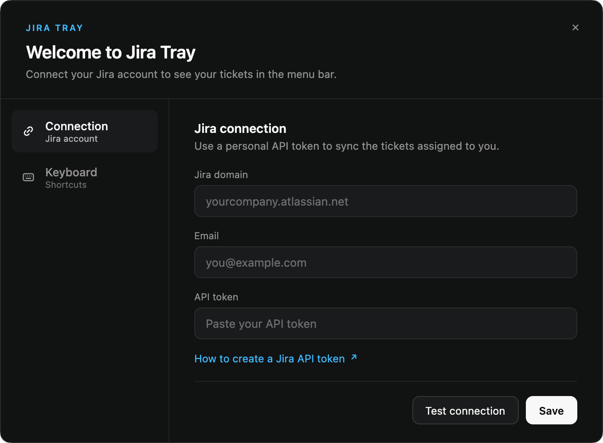
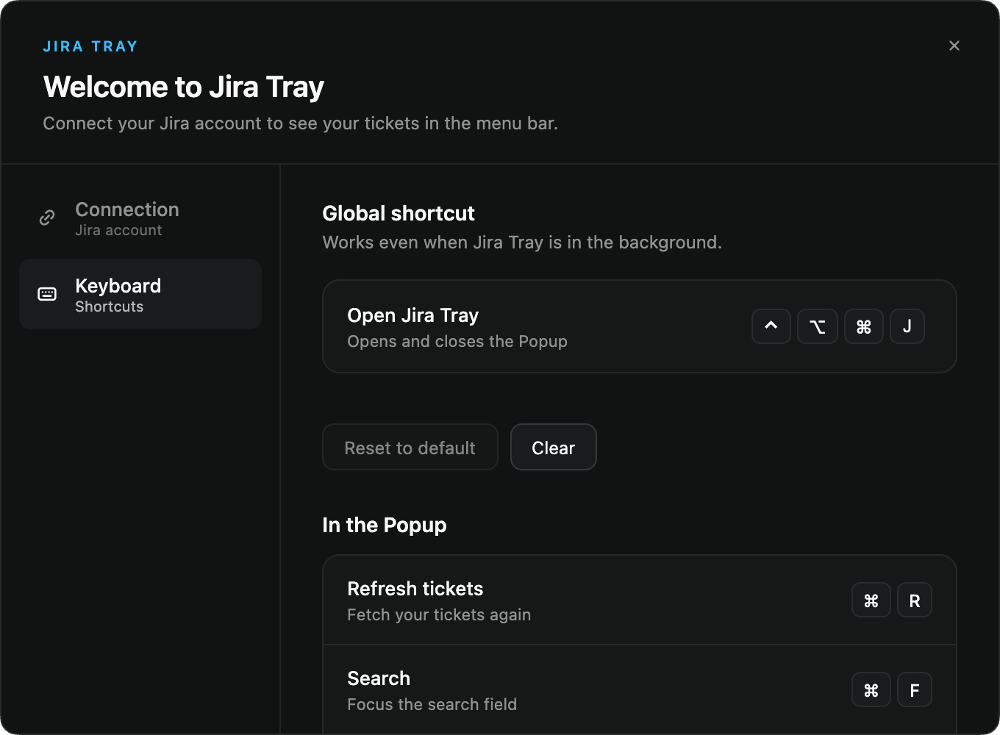

# Jira Tray

[](https://github.com/cassiorsfreitas/jira-tray/actions/workflows/ci.yml)

A macOS menu bar app that shows the Jira tickets assigned to you, grouped by how urgent their due date is. One click or one shortcut, no browser tab.

<p align="center">
  
</p>

## What it does

- Lists your open tickets from every board in one flat list, most urgent first.
- Colours each row by due date: overdue, due today, upcoming, or no date.
- Narrows the list by status, re-sorts it, and searches it as you type.
- Opens a ticket in your browser with a click or <kbd>Enter</kbd>.
- Puts an orange dot on the menu bar icon when something is overdue or due today.
- Opens from the menu bar icon or a global shortcut you choose.

## Requirements

- macOS. Jira Tray is macOS only.
- Node.js 22.13 or newer, and npm, to build it.
- A **Jira Cloud** account (`yourcompany.atlassian.net`) and an [API token](https://id.atlassian.com/manage-profile/security/api-tokens). Jira Server and Data Center are not supported.

## Install

Jira Tray is built from source; there is no download.

```bash
git clone https://github.com/cassiorsfreitas/jira-tray.git
cd jira-tray
npm install
npm run package
```

Then move `out/Jira Tray-darwin-<arch>/Jira Tray.app` into `/Applications` and open it. `<arch>` is `arm64` on Apple Silicon and `x64` on Intel.

- The app is signed ad hoc, not notarized. An app you build yourself is not blocked by Gatekeeper; a copy someone sends you would be.
- The first time it uses your Keychain, macOS asks to allow **Jira Tray Safe Storage**. Answer **Always Allow**. An ad hoc signature changes with every build, so macOS asks once more after you rebuild.
- To uninstall, delete the app, the folder `~/Library/Application Support/Jira Tray` and the Keychain item **Jira Tray Safe Storage**.

## First run

Nothing is configured yet, so the Settings button in the footer of the popup has an orange dot. Open the popup from the menu bar icon, click that button (or press <kbd>⌘</kbd><kbd>,</kbd>), and fill in:

| Field           | What to enter                                                                                |
| --------------- | -------------------------------------------------------------------------------------------- |
| **Jira domain** | `yourcompany.atlassian.net`                                                                  |
| **Email**       | The email of your Atlassian account                                                          |
| **API token**   | A token from [id.atlassian.com](https://id.atlassian.com/manage-profile/security/api-tokens) |

<p align="center">
  
</p>

**Test connection** checks them against Jira; **Save** stores them and loads your tickets. Come back to the same button whenever you want to change them. The dot returns by itself if Jira starts rejecting your credentials, for example when a token expires.

## Using it

Open the popup from the menu bar icon or with <kbd>⌃</kbd><kbd>⌥</kbd><kbd>⌘</kbd><kbd>J</kbd>. Close it with <kbd>Esc</kbd>, the same shortcut, or by clicking elsewhere. Quit from the button in the popup header.

**Which tickets.** Tickets assigned to you that are not Done, and whose status is **To Do** or **In Progress**; tickets in any other status are not shown. Jira Tray asks Jira for one page of results (up to 50 tickets) and does not page through more.

**When it updates.** Each time you open the popup, on <kbd>⌘</kbd><kbd>R</kbd>, and after you save your settings. There is no background polling, so the dot on the menu bar icon reflects the last time tickets were fetched.

**Due dates.**

| Badge                            | Meaning                      | Accent bar |
| -------------------------------- | ---------------------------- | ---------- |
| **Overdue** (red)                | The due date is before today | Red        |
| **Today** (yellow)               | Due today                    | Yellow     |
| A short date, e.g. Nov 12 (grey) | Due later                    | Yellow     |
| None                             | No due date                  | Grey       |

**Filtering and sorting.** The tabs **All**, **In progress** and **To do** show how many tickets each holds. Sort by **Due date** (most urgent first) or **Newest first**. Search matches the ticket key, title and board. Your tab and sort choice are remembered.

### Keyboard shortcuts

The global shortcut works from any app. Change it in **Settings → Keyboard**: click it, press the new combination, and use **Clear** to open only from the menu bar icon or **Reset to default** to go back. It needs at least one modifier key.

| Where    | Keys                                                | Action                                        |
| -------- | --------------------------------------------------- | --------------------------------------------- |
| Anywhere | <kbd>⌃</kbd><kbd>⌥</kbd><kbd>⌘</kbd><kbd>J</kbd>    | Open or close the popup (default, changeable) |
| Popup    | <kbd>⌘</kbd><kbd>R</kbd>                            | Refresh tickets                               |
| Popup    | <kbd>⌘</kbd><kbd>F</kbd>                            | Search                                        |
| Popup    | <kbd>⌃</kbd><kbd>J</kbd> / <kbd>⌃</kbd><kbd>K</kbd> | Move the selection down and up                |
| Popup    | <kbd>Tab</kbd> / <kbd>⇧</kbd><kbd>Tab</kbd>         | Next and previous tab                         |
| Popup    | <kbd>Enter</kbd>                                    | Open the selected ticket                      |
| Popup    | <kbd>⌘</kbd><kbd>,</kbd>                            | Open Settings                                 |
| Popup    | <kbd>Esc</kbd>                                      | Close the popup                               |

<p align="center">
  
</p>

## Privacy and security

- Jira Tray only talks to your Jira site, over HTTPS, to read your tickets. It has no analytics, telemetry or automatic updates.
- Your domain and email are stored in `~/Library/Application Support/Jira Tray`. The API token is encrypted with the macOS Keychain (Electron `safeStorage`) and is never shown again.
- Nothing is written to the project folder, and there is no `.env` file.
- To report a vulnerability, see [SECURITY.md](SECURITY.md).

## Troubleshooting

**The Settings button has an orange dot.** There are no credentials yet, or Jira rejected them (an expired or revoked token, a wrong email). Open Settings and use **Test connection**.

**"Secure storage is not available on this Mac".** macOS refuses Keychain access to an app whose signature is broken. Build with `npm run package` without editing the bundle by hand, and check that `codesign -v "/Applications/Jira Tray.app"` prints nothing. If macOS asked for Keychain access and you chose **Deny**, quit the app and try again.

**The global shortcut does nothing.** Another app may already use it: Settings → Keyboard says so when macOS refuses it. Pick another combination. Electron's global shortcuts are also known to misbehave with some non-QWERTY keyboard layouts.

**A ticket is missing.** Check that it is assigned to you, not Done, in the status To Do or In Progress, and that you do not have more than 50 matching tickets.

## Contributing

Bug reports and pull requests are welcome. [CONTRIBUTING.md](CONTRIBUTING.md) covers the setup, the project layout and the conventions.

## License

[MIT](LICENSE)
